# Lab 01 - SIEM Home Lab: Detection & Log Analysis with Wazuh

   

## 1. Objective

Build a SIEM/XDR environment from scratch with Wazuh, enroll a Windows 11 endpoint agent, and validate detection through File Integrity Monitoring (FIM) and custom detection rules (SSH brute-force detection and event correlation), including a live attack simulation.

**Skills demonstrated:** SIEM deployment, agent management, FIM, log analysis, custom decoder/rule writing, event correlation, attack simulation, MITRE ATT&CK mapping.

> This lab was originally built as part of the **MediShield** project. This repository documents it as a standalone, reproducible lab.

## 2. Architecture

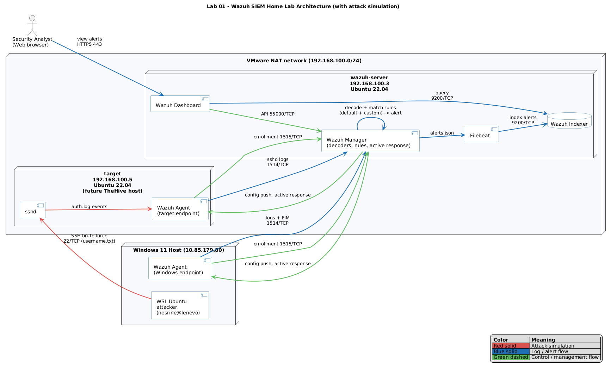

Diagram source: [`architecture.puml`](architecture.puml)

| Machine | Role | OS | IP (lab network) | Resources |
|---|---|---|---|---|
| wazuh-server (VM) | Manager + Indexer + Dashboard | Ubuntu Server 22.04 | 192.168.100.3 | 2 vCPU / 10 GB RAM / 50 GB |
| target (VM) | Monitored endpoint (Wazuh agent + sshd), future TheHive host | Ubuntu Server 22.04 | 192.168.100.5 | 4 vCPU / 8 GB RAM / 40 GB |
| windows (host) | Monitored endpoint (Wazuh agent) | Windows 11 | 10.85.179.80 | 24 GB RAM / 490 GB |
| attacker (WSL) | Attack source for the brute-force simulation | Ubuntu (WSL2 on Windows host) | shares host IP (10.85.179.80) | - |

- Virtualization: VMware, NAT network (192.168.100.0/24)
- Wazuh version: `4.8.2`
- Attacker machine: WSL Ubuntu on the Windows host (`nesrine@lenevo`), used only to launch the SSH brute-force test against `target`

### 2.1 Log flow (endpoints -> SIEM)

| Step | From | To | Protocol / Port | Description |
|---|---|---|---|---|
| 1 | Wazuh agents (Windows 11, target) | Wazuh manager | 1514/TCP (encrypted) | Event logs, FIM events and sshd logs sent to the manager |
| 2 | Wazuh manager | Wazuh manager | internal | Decoders and rules (default + custom) analyse events and generate alerts |
| 3 | Wazuh manager | Filebeat | local (`alerts.json`) | Alerts forwarded by Filebeat |
| 4 | Filebeat | Wazuh indexer | 9200/TCP (TLS) | Alerts indexed and stored |
| 5 | Wazuh dashboard | Wazuh indexer | 9200/TCP (TLS) | Alerts queried for visualization |
| 6 | Analyst (browser) | Wazuh dashboard | 443/HTTPS | Alerts reviewed and investigated |

### 2.2 Control flow (Wazuh -> endpoints)

| From | To | Protocol / Port | Description |
|---|---|---|---|
| Wazuh agents | Wazuh manager | 1515/TCP | Agent enrollment (registration) |
| Wazuh manager | Wazuh agents | over the 1514 channel | Centralized control: configuration push, group policy, active response, restart |
| Wazuh dashboard | Wazuh manager | 55000/TCP | Management through the Wazuh REST API |

### 2.3 Attack flow (simulation)

| From | To | Protocol / Port | Description |
|---|---|---|---|
| attacker (WSL Ubuntu) | target | 22/TCP (SSH) | SSH brute-force attempts using a username wordlist (`username.txt`) |
| target (sshd) | Wazuh agent (target) | local | Failed/successful login attempts logged to `/var/log/auth.log` |

## 3. Prerequisites

- VMware (Workstation) installed on the Windows 11 host
- Ubuntu Server 22.04 ISO (x2: wazuh-server, target)
- WSL2 with an Ubuntu distro installed on the Windows host (attacker machine)
- Minimum 10 GB of free RAM on the host for the wazuh-server VM, plus 8 GB for the target VM
- Network connectivity between host, VMs and WSL through the VMware NAT network (ports 22, 1514, 1515, 443, 55000)
- An SSH brute-force tool available in WSL (e.g. Hydra: `sudo apt install hydra`)

## 4. Implementation

### 4.1 Virtual machines and network

Create two VMs in VMware on the **NAT** network (192.168.100.0/24):
- `wazuh-server`: 2 vCPU / 10 GB RAM / 50 GB disk, Ubuntu Server 22.04, static IP `192.168.100.3`
- `target`: 4 vCPU / 8 GB RAM / 40 GB disk, Ubuntu Server 22.04, static IP `192.168.100.5`, with `openssh-server` installed and enabled

Verify that the Windows host, WSL, and both VMs can reach each other on the NAT network.

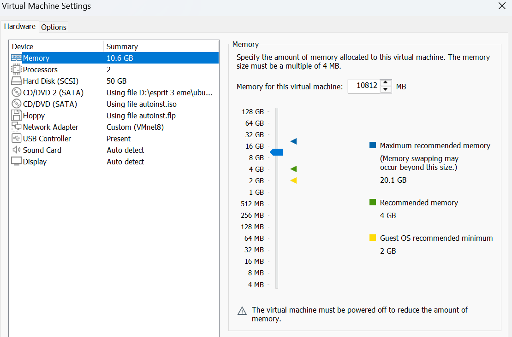
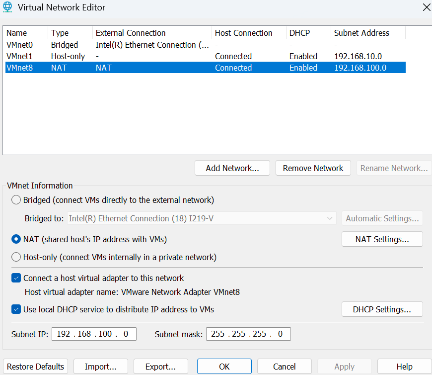

### 4.2 Wazuh server installation

On the `wazuh-server` VM:
```bash
curl -sO https://packages.wazuh.com/4.8/wazuh-install.sh
sudo bash ./wazuh-install.sh -a
```
Save the generated admin credentials in a password manager. Never commit them.

Check the services:
```bash
sudo systemctl status wazuh-manager wazuh-indexer wazuh-dashboard
```


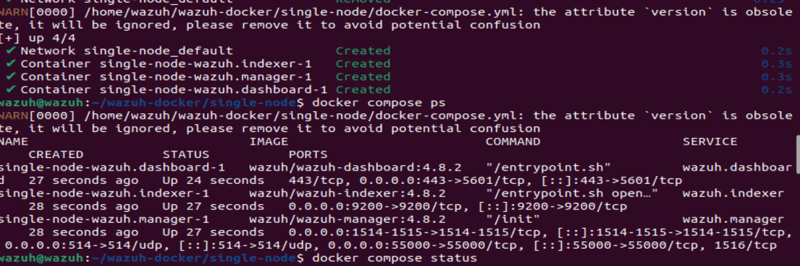
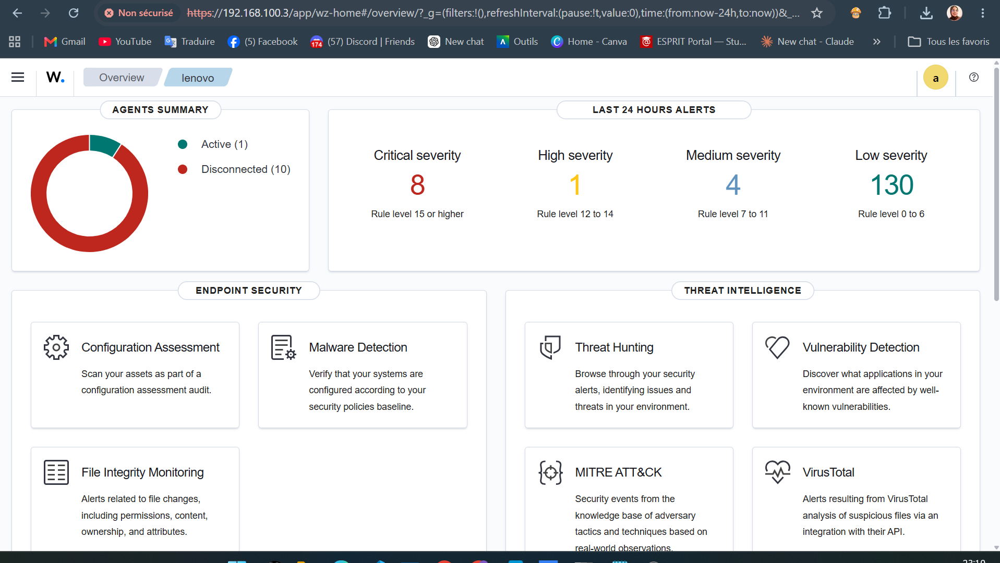

### 4.3 Agent deployment

**Windows 11 (administrator PowerShell):**
```powershell
Invoke-WebRequest -Uri https://packages.wazuh.com/4.x/windows/wazuh-agent-4.8.2-1.msi -OutFile $env:tmp\wazuh-agent.msi
msiexec.exe /i $env:tmp\wazuh-agent.msi /q WAZUH_MANAGER='192.168.100.3' WAZUH_AGENT_NAME='windows-endpoint'
NET START Wazuh
```

**target (Ubuntu 22.04):**
```bash
curl -so wazuh-agent.deb https://packages.wazuh.com/4.x/apt/pool/main/w/wazuh-agent/wazuh-agent_4.8.2-1_amd64.deb \
  && sudo WAZUH_MANAGER='192.168.100.3' WAZUH_AGENT_NAME='target' dpkg -i ./wazuh-agent.deb
sudo systemctl daemon-reload
sudo systemctl enable --now wazuh-agent
```


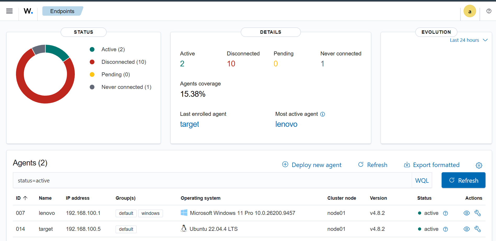

### 4.4 File Integrity Monitoring (FIM)

Configuration on the Windows agent, in `C:\Program Files (x86)\ossec-agent\ossec.conf` (excerpt, see [`configs/ossec-agent-fim.conf`](configs/ossec-agent-fim.conf)):
```xml
<syscheck>
  <disabled>no</disabled>
  <frequency>300</frequency>

  <!-- Custom: real-time monitoring of the lab directory -->
  <directories check_all="yes" realtime="yes">C:\lab-monitor</directories>

  <!-- All other entries (Windows system files, registry keys) are left at the Wazuh defaults -->
</syscheck>
```
All default Windows FIM entries (system binaries, startup folder, registry keys) were left unchanged.

Restart the agent (administrator PowerShell):
```powershell
Restart-Service -Name Wazuh
```

Test:
```powershell
New-Item -ItemType Directory -Force -Path C:\lab-monitor
"test" | Out-File C:\lab-monitor\file.txt        # file added
Add-Content C:\lab-monitor\file.txt "modified"   # file modified
Remove-Item C:\lab-monitor\file.txt              # file deleted
```

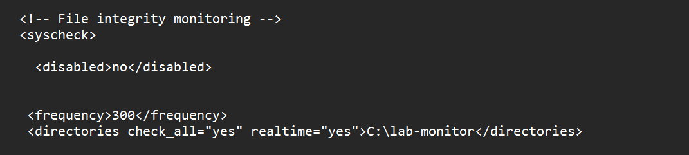
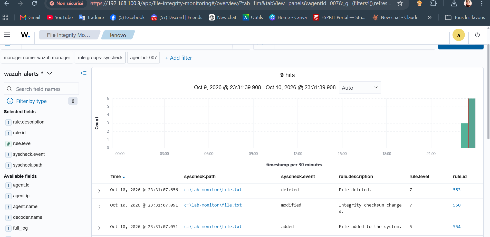


### 4.5 Custom rules

I extended Wazuh's default SSH rules with a **three-tier brute-force detection chain**: a single failed login is tagged at low severity (level 5), repeated failures from the same source IP within 60 seconds escalate to suspicious (level 10), and a sustained attack triggers an emergency alert (level 16). I also wrote a **correlation rule** that raises an urgent alert when a user logs in shortly after a malware detection on the same endpoint.

File on the manager: `/var/ossec/etc/rules/local_rules.xml` (copy in [`configs/local_rules.xml`](configs/local_rules.xml)).

Rule IDs from 100000 to 120000 are reserved for custom rules.

```xml
<group name="local,syslog,sshd,">

  <!-- Tier 1: every failed SSH login (child of default rule 5716) -->
  <rule id="100090" level="5">
    <if_sid>5716</if_sid>
    <description>SSHD: Failed login attempt</description>
    <mitre>
      <id>T1110</id>
    </mitre>
  </rule>

  <!-- Tier 2: repeated failures from the same source IP -->
  <rule id="100091" level="10" frequency="5" timeframe="60">
    <if_matched_sid>100090</if_matched_sid>
    <same_source_ip />
    <description>Suspicious: repeated SSH failures from $(srcip)</description>
    <mitre>
      <id>T1110</id>
    </mitre>
  </rule>

  <!-- Tier 3: sustained brute-force attack -->
  <rule id="100060" level="16" frequency="15" timeframe="60">
    <if_matched_sid>100090</if_matched_sid>
    <same_source_ip />
    <description>EMERGENCY: Ongoing SSH Brute Force Attack from $(srcip)</description>
    <group>authentication_failures,</group>
    <mitre>
      <id>T1110</id>
    </mitre>
  </rule>

</group>

<group name="local,windows,">

  <!-- Correlation: Windows logon shortly after a malware detection -->
  <rule id="100095" level="13" timeframe="300">
    <if_sid>60106</if_sid>
    <if_matched_sid>100005</if_matched_sid>
    <description>Urgent: User login immediately following malware detection!</description>
  </rule>

</group>
```

| Rule ID | Level | Purpose | Logic | MITRE |
|---|---|---|---|---|
| 100090 | 5 | Tag every failed SSH login | Child of default rule 5716 | T1110 |
| 100091 | 10 | Detect repeated failures | 5 x rule 100090 within 60 s, same source IP | T1110 |
| 100060 | 16 | Emergency: ongoing brute force | 15 x rule 100090 within 60 s, same source IP | T1110 |
| 100095 | 13 | Login right after malware detection | Windows logon success (60106) within 300 s of rule 100005 (`<describe rule 100005>`) | `<technique>` |

**Why these design choices**
- `if_sid` chains a rule to a parent, while `if_matched_sid` with `frequency` and `timeframe` correlates repeated events.
- `same_source_ip` ensures failures from different attackers are never counted together.
- Severity escalates with attack intensity so analysts can triage quickly. Thresholds can be tuned (and admin IPs whitelisted) to reduce false positives.

Validate and apply (on `wazuh-server`):
```bash
sudo /var/ossec/bin/wazuh-logtest          # paste a sample log, check the rule that fires
sudo systemctl restart wazuh-manager
```


### 4.6 Active response: auto-block the attacker

To go beyond detection, I configured Wazuh's **Active Response** so a sustained brute-force attack (rule `100060`) automatically blocks the attacker's IP on `target` with `firewall-drop`.

On the manager, in `/var/ossec/etc/ossec.conf`:
```xml
<command>
  <name>firewall-drop</name>
  <executable>firewall-drop</executable>
  <timeout_allowed>yes</timeout_allowed>
</command>

<active-response>
  <command>firewall-drop</command>
  <location>local</location>
  <rules_id>100060</rules_id>
  <timeout>600</timeout>
</active-response>
```
- `rules_id` ties the response to Tier 3 of the SSH brute-force chain (level 16, sustained attack).
- `timeout` unblocks the IP automatically after 600 seconds (10 minutes), useful in a lab so you don't lock yourself out permanently.

When the response runs, Wazuh logs it and fires its own **default rule `651`** as confirmation:

```xml
<!-- Default Wazuh rule (not custom) - confirms the active response executed -->
<rule id="651" level="3">
  <if_sid>650</if_sid>
  <field name="parameters.program">firewall-drop</field>
  <field name="command">add</field>
  <description>Host Blocked by firewall-drop Active Response</description>
  <group>active_response,pci_dss_11.4,gpg13_4.13,gdpr_IV_35.7.d,nist_800_53_SI.4,tsc_CC6.1,tsc_CC6.8,tsc_CC7.2,tsc_CC7.3,tsc_CC7.4,</group>
</rule>
```

Restart the manager to apply:
```bash
sudo systemctl restart wazuh-manager
```

Verify the block on `target`:
```bash
sudo iptables -L -n | grep DROP
```

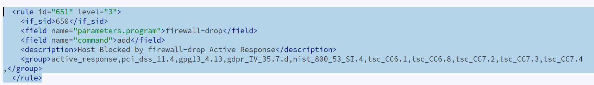
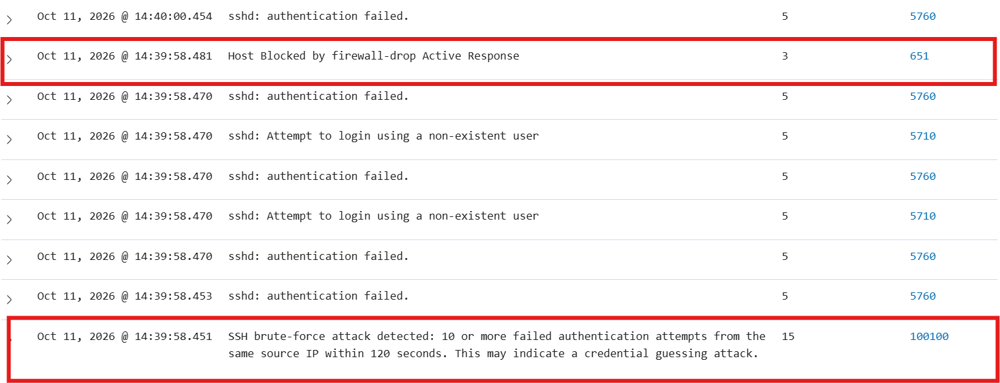

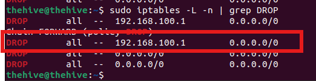

### 4.7 Attack simulation: SSH brute force

**Setup:** attacker = WSL Ubuntu on the Windows host, target = `target` VM (192.168.100.5).

Wordlist on the attacker (`/tmp/username.txt`):
```
root
admin
ubuntu
test
nesrine
victim
user
support
backup
guest
```
(`/tmp/passwords.txt`):

```
root
admin
ubuntu
test
nesrine
victim
user
support
backup
guest
```

Run the attack from WSL:
```bash
sudo apt install hydra -y
hydra -L /tmp/usernames.txt       -P /tmp/passwords.txt       -t 4       -V       -f       192.168.100.5 ssh
```

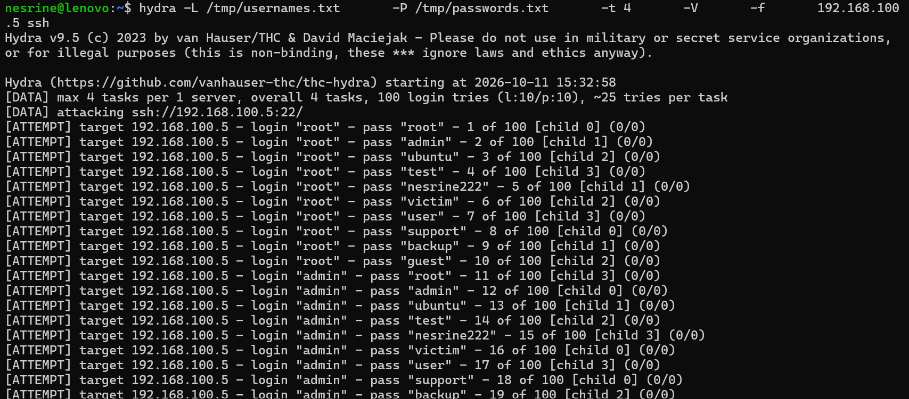
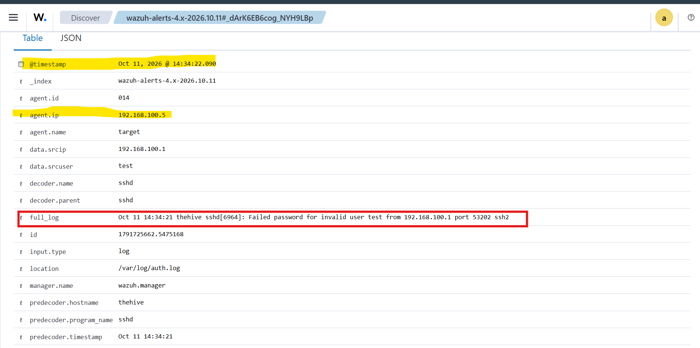 
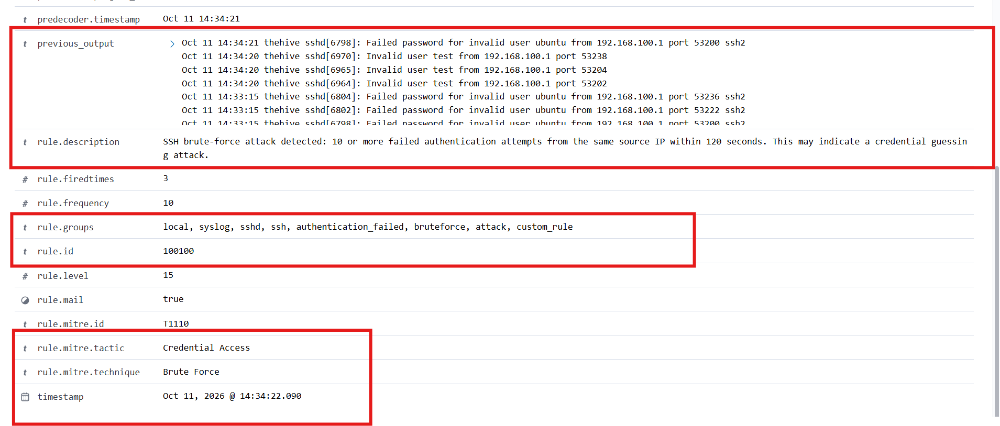
(screenshots/16-attack-alerts.png)

## 5. Results

- Windows 11 and target agents enrolled and reporting to the Wazuh manager
- FIM detected file creation, modification and deletion in real time on Windows
- The simulated SSH brute force from WSL escalated the alert chain from level 5 to 10 to 16 as the attack intensified
- Custom rules mapped to MITRE ATT&CK (T1110) and visible in the dashboard
- The level-16 alert triggered the `firewall-drop` Active Response, automatically blocking the attacker's IP on `target` and confirmed by default rule 651

## 6. Challenges and lessons learned

**Challenges**
- **Network connectivity:** getting the host, WSL, and the VMware NAT network to all reach each other was the first blocker. Attempts from WSL to the VMs (and vice versa) initially failed, which meant retracing the NAT setup and testing connectivity at each hop (`ping`, `telnet <ip> <port>`) before moving on.
- **Wazuh configuration:** the first manager/agent setup didn't come up cleanly (service status, agent registration). Working through the logs (`/var/ossec/logs/ossec.log` on the manager, the agent log on Windows) to find the exact point of failure was what got it running reliably.

**What I learned**
- How to deploy a SIEM from scratch to monitor multiple endpoints, without relying on a SOAR platform: Wazuh's own correlation and active-response engine was enough to detect and react to an attack end to end.
- How to write and validate custom detection rules (the SSH brute-force tier chain and the login-after-malware correlation rule), using `wazuh-logtest` to confirm each one fires as intended.
- How to configure Active Response so the SIEM reacts automatically to a sustained attack, without a separate SOAR layer.
- How to protect a specific file directory with File Integrity Monitoring, and read FIM events through to a dashboard alert.
- How to manage agents across two different operating systems (Windows and Linux) from a single manager, each with its own install and config path.

**What I'd improve next**
- Forward alerts to Slack or email for real-time notification
- Deploy TheHive on `target` for case management and incident tracking
- Add a second Linux agent to broaden log coverage
- Tune the active-response timeout and whitelist trusted IPs to reduce the risk of false positives in a more realistic setup

## 7. Repository structure

```
01-siem-home-lab/
├── README.md
├── architecture.puml
├── configs/
│   ├── ossec-agent-fim.conf
│   └── local_rules.xml
├── screenshots/
└── test-logs/
    └── username.txt
```

## 8. Disclaimer

Educational lab in an isolated environment, performed only against systems I own and control. All credentials and sensitive data have been removed.
